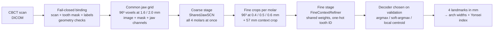

# 3-D Deep Learning for Molar Landmark Detection in Dental CBCT

**Coarse-to-fine 3-D U-Net with spatial-configuration gating that finds the centre of resistance of all four first molars in cone-beam CT, for automated Yonsei transverse analysis in orthodontics.**


| | |
| --- | --- |
| **Task** | 3-D landmark localisation: 4 points per scan (UL6, UR6, LR6, LL6 furcation centres) |
| **Data** | 224 clinical CBCT scans with tooth masks and expert landmarks (not included) |
| **Model** | Coarse-to-fine CompactUNet3D + Spatial Configuration Network (SCN), trained from scratch |
| **Blind test** | 26 held-out patients, labels locked until predictions were frozen and hashed |
| **Headline** | Median error **0.55 mm**; all four molars within 2 mm in **20 / 26** patients |
| **Baseline** | Rule-based PCA method on the same masks: median error 1.32 mm, 14 / 26 patients |

<p align="center">
  
</p>

*One blind test patient. Yellow: expert reference points and basal width; red: the model's predictions. The predicted widths differ from the expert's by 0.37 mm (maxillary, 39.04 vs 39.41 mm) and 0.08 mm (mandibular, 48.57 vs 48.49 mm).*

---

## Why this problem

Orthodontists judge whether the upper jaw is too narrow with the **Yonsei transverse analysis** (Koo et al., 2017). It compares the distance between the centres of resistance of the upper first molars with that of the lower first molars. Placing those four points by hand in a 3-D scan is slow and varies between clinicians, so the analysis is rarely done routinely.

This project automates the four points. With them, the upper and lower basal widths and the Yonsei index follow directly.

## Pipeline



**Coarse stage.** A compact 3-D U-Net predicts one heatmap per molar on a low-resolution grid of the whole jaw. A Spatial Configuration Network branch then looks at all four heatmaps together at 1/8 resolution and learns where the molars sit relative to each other (left/right, upper/lower). The two are fused in log space, which suppresses detections in anatomically implausible places.

**Fine stage.** Around each coarse prediction, a 0.4–0.6 mm crop and a larger context crop are cut. One shared refiner network, told which tooth it is looking at by constant one-hot channels, predicts a sharp heatmap. A fallback head predicts directly in the context crop when the local prediction lands near the crop edge.

**Training details.** Gaussian cross-entropy heatmap loss with a coordinate term (σ = 3.2 mm coarse, 1.0 mm fine); coupled affine augmentation (±8° rotation, ±4 mm shift, 0.9–1.1 scale) and left/right flipping with label swapping; three jittered fine-crop replicates per case; optional auxiliary tooth-mask head as a pre-specified ablation. Model duration and decoder are selected on validation only, then the model is refit from random initialisation on all development cases and frozen.

More detail: [`docs/method.md`](docs/method.md).

## Results

Blind internal test on **26 patients (104 landmarks)** that were never used for training or model selection. Every failed case stays in the denominator.

| Metric | Deep learning (this repo) | PCA rule baseline |
| --- | --- | --- |
| Median landmark error | **0.55 mm** (IQR 0.34–0.86) | 1.32 mm (IQR 1.01–1.82) |
| Landmarks within 1 mm | **77 / 104** | 24 / 104 |
| Landmarks within 2 mm | **83 / 104** | 80 / 104 |
| Patients with all four molars within 2 mm | **20 / 26** (77%, 95% CI 58–89%) | 14 / 26 |
| Closer to the reference, paired landmarks | **83 / 96** | — |

* In the 20 fully successful patients the mean error is **0.52 mm** (maximum 1.12 mm), below the size of a few CBCT voxels.
* The PCA baseline places points about 1.1 mm too far toward the root tips; the deep model's vertical bias is under 0.1 mm.
* Of the six patients that did not fully pass, four trace back to data problems found by the automated test-data check (an unreadable scan export, reference points recorded on a different scan series, a mask without molar labels, and reference points away from the molars). One is a genuine miss of 3–6.5 mm, and one has a single molar off by 5.3 mm.

The numbers above come from the frozen model after one reader fix that the test-data check allowed (an Enhanced-CT header read as classic slices). That fix changed one case only; the original locked run gave 19 / 26. Both runs are kept and reported. See [`docs/results.md`](docs/results.md) for the full breakdown.

> These are internal results on one centre's data. The model has not been externally validated and is not a medical device.

## Engineering highlights

What took most of the work was not the network but making the evaluation trustworthy on messy clinical data:

* **Frozen split and locked labels.** The 118 / 25 / 26 split is pinned by SHA-256. Test coordinates are opened only after all 104 blind predictions are written and byte-hashed.
* **Patient-level leakage checks.** Scans are matched by DICOM patient, study and series identity, so no patient appears in two split roles, even under a different folder name.
* **Fail-closed data binding.** Each scan is bound to its mask and landmarks only if the geometry agrees. The binder found and repaired, with audited fixes, mask headers with no origin, a mask saved upside down, scans filed under two patient records, and a renamed Drive folder.
* **Coordinate safety.** All points move through explicit voxel-to-world (RAS, mm) transforms; label QA reports how far every reference point sits from its own tooth mask.
* **Readable, checked code.** 22 numbered stage files instead of 600 KB of notebook cells, formatted and linted with Ruff in CI.
* **Resumable training on a free GPU.** Eight fits (selection, 4-fold cross-fit, refit) with per-epoch checkpoints, crop caches and run savers so a Colab disconnect costs minutes, not hours.
* **Statistics a reviewer expects.** Patient-level bootstrap and Wilson 95% CIs, success-detection rates at 0.5–4 mm, per-molar tables, McNemar and Wilcoxon tests against the baseline, and Yonsei width / index agreement.

## Repository layout

```
.
├── src/cbct_cor/                              # the pipeline, one file per stage (01-22)
│   ├── 01_config.py … 10_bind_sources.py      # configuration, DICOM/NIfTI I/O, fail-closed binding
│   ├── 11_data_upgrade.py … 17_*.py           # crops, model, losses, training and evaluation code
│   ├── 18_build_caches.py … 20_blind_test.py  # full pipeline: caches → train and lock → blind test
│   ├── 21_test_data_check.py, 22_*.py         # testing only: data check → corrected re-test
│   └── README.md                              # stage table and how the stages run
├── notebooks/
│   ├── cbct_cor_v19plus_full_pipeline.ipynb   # setup + experiment config + run_stage() calls
│   └── cbct_cor_v19plus_testing_only.ipynb    # evaluation of the frozen model only
├── docs/
│   ├── method.md                              # model, training and evaluation protocol
│   ├── results.md                             # full test results and failure analysis
│   └── data-access.md                         # private inputs and environment variables
├── config/                                    # example config shapes (no real values)
├── tools/sanitize-notebooks.mjs               # strips private identifiers before publishing
├── pyproject.toml                             # Ruff format and lint settings
├── .github/workflows/lint.yml                 # CI: format check, lint, byte-compile
└── requirements-colab.txt                     # pinned imaging packages
```

The notebooks are short: package setup, Drive mount, the experiment configuration (`V19_CONFIG`) and one `run_stage("NN_name")` call per step. All pipeline code lives in [`src/cbct_cor/`](src/cbct_cor/), where it can be read, diffed and linted like any Python project.

## Running it

The clinical data cannot be shared, so the notebooks will not run end to end without the private study bundle. To run them with authorised access:

1. Open a notebook in Google Colab with a T4 GPU runtime.
2. Make the code available: clone this repository to `/content/cbct-cor-v19plus`, or copy `src/cbct_cor/` to Drive and set `CBCT_COR_SRC` to that folder.
3. Put the private files listed in [`docs/data-access.md`](docs/data-access.md) in `CBCT_COR_PRIVATE_DATA_DIR` and set the Drive environment variables.
4. *Runtime → Run all.* A full training run takes about 20 hours on a T4, most of it cutting fine crops. The testing-only notebook takes about 2 hours.

## Tech stack

PyTorch · MONAI · NumPy / SciPy · SimpleITK · pydicom · nibabel · scikit-image · pandas · Matplotlib · safetensors · Google Colab · Ruff · GitHub Actions

## Privacy

The notebooks are sanitized with [`tools/sanitize-notebooks.mjs`](tools/sanitize-notebooks.mjs): saved outputs are cleared, Drive identifiers come from environment variables, and embedded study files are replaced by loaders. No scans, masks, coordinates, identities, weights or case-level results are in this repository.

## Author

**Basma Tarek** · [github.com/Basma2753](https://github.com/Basma2753)

No open-source licence has been granted; all rights reserved.
